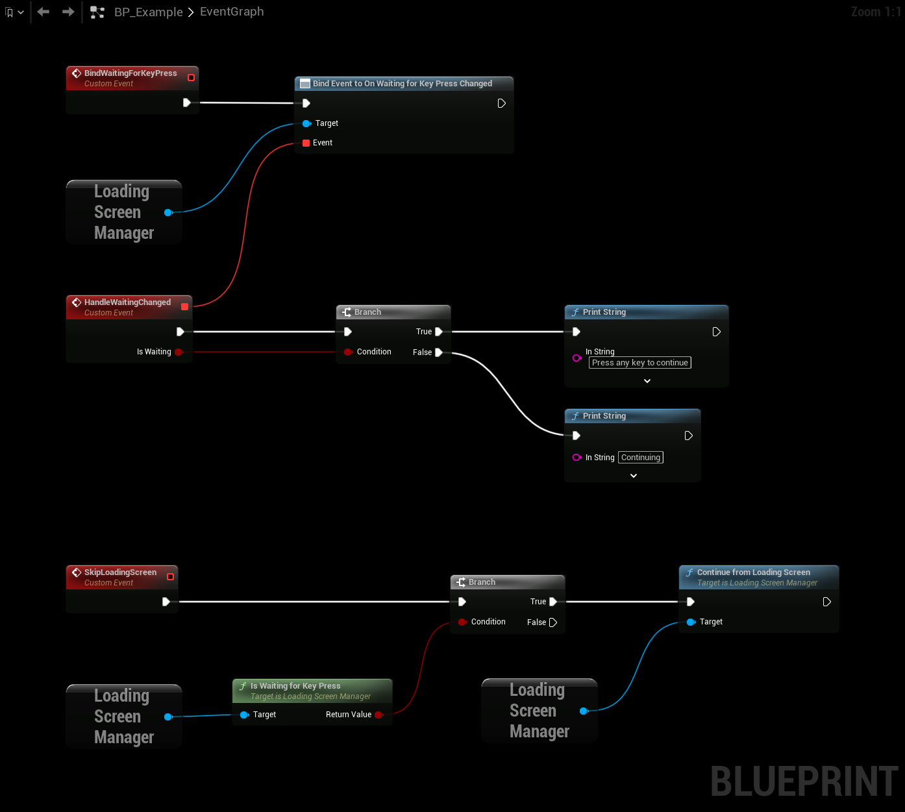
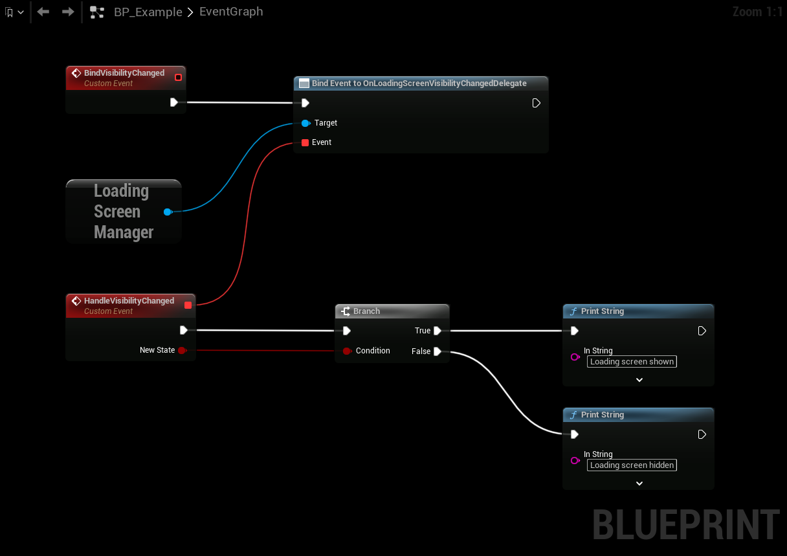
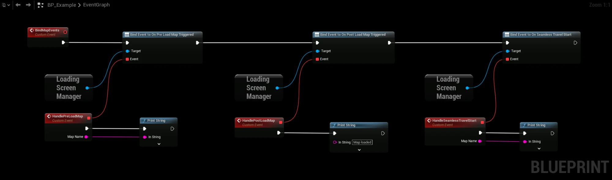

# When the Loading Screen Is Shown

The **Loading Screen Manager** is a Game Instance Subsystem. Every frame it asks a list of questions, in order. The first one that says "show" wins, and its answer becomes the [reason](/docfiles/getting_started/reason) for the loading screen.

## The checks, in order
1. **Force Visible** (or `CommonLoadingScreen.AlwaysShow`) is on.
2. There is no world yet, or the Game State has not replicated.
3. A map is being loaded, unless the map is blocked in **Blocked Map Names** or **Blocked Maps**.
4. There is a pending travel, unless the target map is blocked.
5. The game is connecting to a server.
6. The world has not begun play.
7. The game is in seamless travel.
8. The **Game State** or one of its components returns true from **Should Show Loading Screen**.
9. A registered loading process returns true, for example a task from [Create Loading Screen Process Task](/docfiles/getting_started/on-demand).
10. A local **Player Controller** or one of its components returns true from **Should Show Loading Screen**.
11. A [Watcher](/docfiles/getting_started/watchers) returns true from **Should Show Loading Screen**.
12. No local Player Controller exists yet. In split screen, every local player must have one.

If nothing asks for the loading screen, the reason becomes `(nothing wants to show it anymore)`.

During seamless travel to a blocked map, only the first check is made. The loading screen stays hidden until the travel has finished.

The checks are also made while the game is paused.

## Holding the loading screen up
When nothing needs the loading screen anymore, it stays up for **Additional Hold Time** more, so texture streaming can catch up. The world is rendered behind the loading screen during this time. The **On Show Loading Screen Additional Secs Triggered** event fires with `true` when the hold starts, and with `false` when the loading screen is hidden.

With **Minimum Display Time** set, the loading screen also stays up until it has been visible for at least that long. This keeps a very short load from flashing the loading screen for a single frame. The two times don't add up: the loading screen is hidden when both have passed.

The hold time and the minimum display time do not apply:
- In the editor, unless **Hold Time Even in Editor** is on.
- On blocked maps, or when travelling to one.

## Waiting for a key press
With **Wait For Key Press** on, the loading screen stays up after a map has loaded until the player presses a key, a mouse button or a gamepad button. It is the last thing that happens, after the hold time and minimum display time.

- It only applies when a map was loaded or travelled to, not to a loading screen shown on demand, and not on blocked maps.
- **Is Waiting For Key Press** is true while it waits, and **On Waiting For Key Press Changed** fires when it starts and stops. Use them to show a prompt in your widget. The [built-in loading screen](/docfiles/getting_started/built-in-loading-screen) shows **Key Press Text**.
- Call **Continue From Loading Screen** to continue from your own code, for example from a button.
- A key that was held down before the wait started does not count, and neither does the console key.
- If something asks for the loading screen again during the wait, the wait starts over when it is done.
- In a multiplayer game the world keeps running while the player waits.

This example reacts when the wait starts and stops, and continues from your own code if the loading screen is waiting.

## Fading in
With **Fade In Duration** set, the widget fades in over that many seconds, with the world still rendered behind it.

Loading a map blocks the game thread, so the fade can't run. When a map starts loading the widget becomes fully visible at once. The fade is mainly seen during seamless travel and for loading screens shown on demand.

## Fading out
With **Fade Out Duration** set, the widget fades out over that many seconds instead of disappearing at once.

- The loading screen counts as hidden as soon as the fade starts. **On Loading Screen Visibility Changed Delegate** fires with `false`, input is no longer blocked and the world is rendered behind the widget.
- **Is Loading Screen Fading Out** is true until the widget has been removed.
- If something asks for the loading screen again during the fade, the same widget becomes fully visible again instead of a new one being created.
- The plugin fades the whole widget with its render opacity. To play your own animation instead, bind **On Loading Screen Visibility Changed Delegate** in the widget and start the animation when it fires with `false`. Set the fade duration to the length of the animation.

## Different content for different maps
Add entries to **Map Overrides** to use another widget, movies, tips, images or music while a specific map loads. The override is picked from the map that is being loaded or travelled to when the loading screen is shown. See [Map Overrides](/docfiles/reference/settings#map-overrides).

## While the loading screen is shown
- The widget is added to the game viewport with **Z Order**. The default widget is loaded once when the game starts, so the first loading screen doesn't hitch.
- All keyboard, mouse and gamepad input is blocked. Input is not blocked in the editor. In builds other than Shipping, the console keys and typing in an open console still work, so you can run commands. The console may be drawn behind the loading screen widget.
- The shader pipeline cache compiles in fast mode, and the hitch detector is paused.
- **On Loading Screen Visibility Changed Delegate** fires with `true` when it is shown and `false` when it is hidden.
- A garbage collection runs just before the loading screen is hidden.

This example reacts when the loading screen is shown and hidden.

## Keeping the widget animated while a map loads
Loading a map with **Open Level** blocks the game thread, so the widget stops animating until the map has loaded. Turn on **Use Movie Player During Load Map** to show the widget with Unreal's Movie Player during the load instead. The Movie Player draws it on its own thread, so animations keep playing.

- A second instance of **Loading Screen Widget** is created for the Movie Player.
- The widget is drawn outside the game thread. Animations and bindings work, but don't rely on Blueprint **Tick** or other game logic in it.
- It is only used in a packaged or standalone game, never in the editor.
- It is not used for blocked maps or during seamless travel, which doesn't block the game thread. Loading screen movies are not played for blocked maps either.
- A widget, movies or images from **Map Overrides** are used for the map being loaded.

## Map events
The Loading Screen Manager also forwards these events, which you can bind in Blueprint:

| Event | When |
|---|---|
| On Pre Load Map Triggered | A map starts loading. Gives the map name. |
| On Post Load Map Triggered | The map has finished loading. |
| On Seamless Travel Start | Seamless travel to a map starts. Gives the map name. |

## Turning it off for testing
Start the game with `-NoLoadingScreen` on the command line to never show the loading screen. This works in all builds except Shipping.
