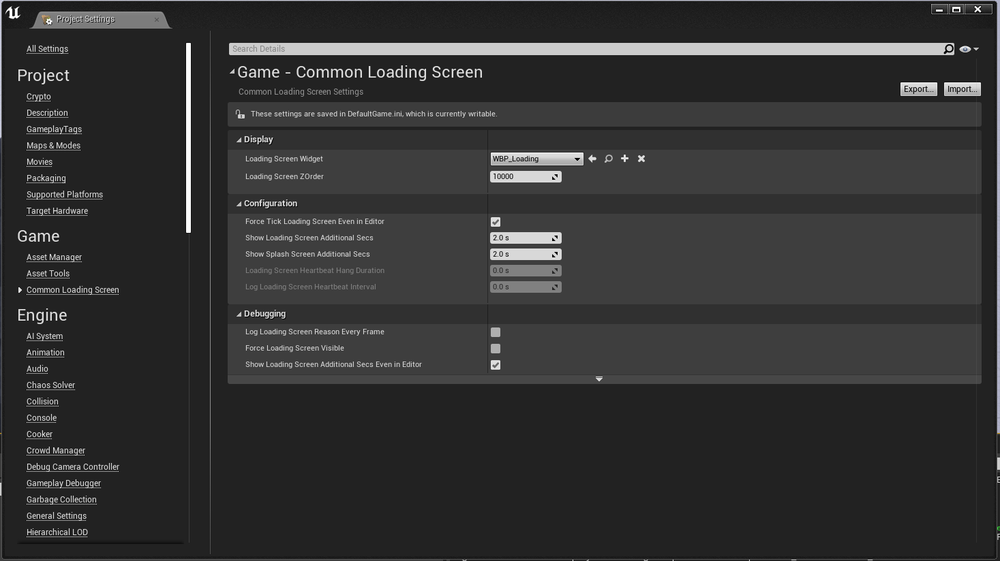

# Configuring the Plugin

You configure the plugin in **Edit → Project Settings → Plugins → Common Loading Screen**. Every setting is described in detail in [Settings and Console Variables](/docfiles/reference/settings).

## Project Settings

### Loading Screen
- **Loading Screen Widget**

  The widget that is displayed when switching maps, or when something tells the plugin to display the loading screen. Leave it empty to use the [built-in loading screen](/docfiles/getting_started/built-in-loading-screen).

- **Z Order**

  This number should be higher than your other widgets, so the loading screen stays on top of them.

- **Automatic Progress**

  Reports loading progress automatically when a map is loaded.

### Timing
- **Additional Hold Time**

  Even after the loading screen has "finished", it continues to display for this many seconds.

- **Minimum Display Time**

  Once shown, the loading screen stays up for at least this many seconds, so short loads don't flicker.

- **Fade In Duration** and **Fade Out Duration**

  How many seconds the widget fades in when the loading screen is shown, and fades out when it is hidden.

- **Wait For Key Press**

  Keeps the loading screen up after a map has loaded until the player presses a key.

### Status Text
The texts that tell the player what the game is doing. See [Status Text](/docfiles/getting_started/reason#status-text).

### Built-in Loading Screen
The layout, title, spinner, logo and colors of the [built-in loading screen](/docfiles/getting_started/built-in-loading-screen). These settings can only be edited when **Loading Screen Widget** is empty.

### Content
[Tips, images, music](/docfiles/getting_started/tips-slideshow-music) and [movies](/docfiles/reference/settings#movies).

### Maps
- **Map Overrides**

  A different widget, movies, tips, images or music for specific maps. See [Map Overrides](/docfiles/reference/settings#map-overrides).

- **Blocked Map Names**

  Maps that never show a loading screen when they are loaded, by name.

- **Blocked Maps**

  The same as **Blocked Map Names**, but you pick the maps from a list.

### Splash Screen
- **Disable Splash Screen**

  Turns off the splash screen on game startup.

- **Splash Screen Type**

  The splash screen shown on game startup: `BLACK`, `LOADING`, `IMAGE` or `VIDEO`. See [Splash Screen](/docfiles/concepts/splash-screen).

- **Splash Additional Hold Time**

  The splash screen is displayed for this many extra seconds on game startup.

### Debugging
- **Log Reason Every Frame**

  Logs the reason why the loading screen is currently shown.

- **Force Visible**

  Forces the loading screen to always show.

- **Hold Time Even in Editor**

  Shows the loading screen for the additional seconds also when running in the editor.

- **Force Tick Even in Editor**

  Lets the loading screen tick also when running in the editor.

- **Heartbeat Hang Duration**

  Detects if the loading screen has hung or frozen.

- **Log Heartbeat Interval**

  How often to log what is keeping the loading screen up.

## Next step
[Create your loading screen widget](/docfiles/getting_started/using-plugin).
