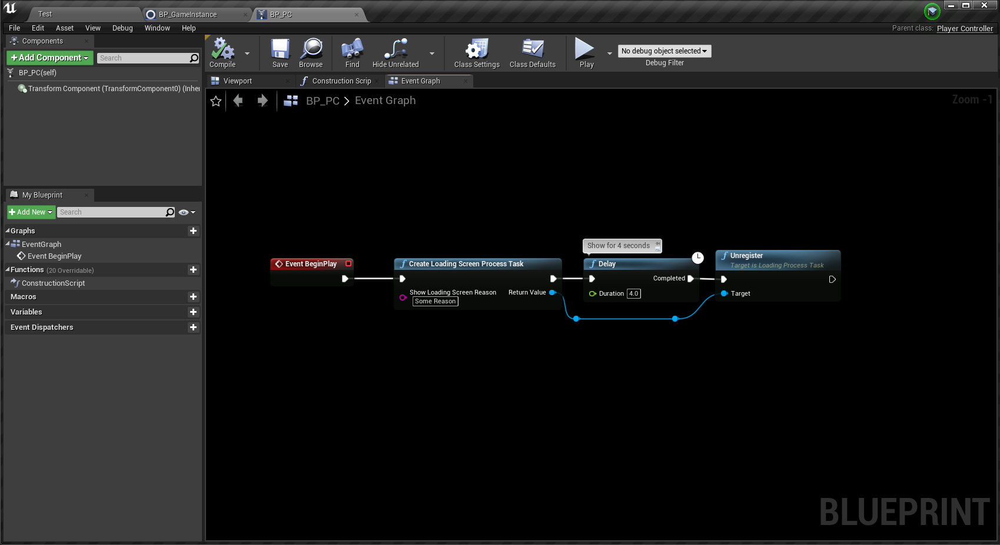
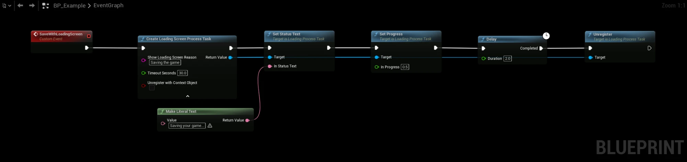
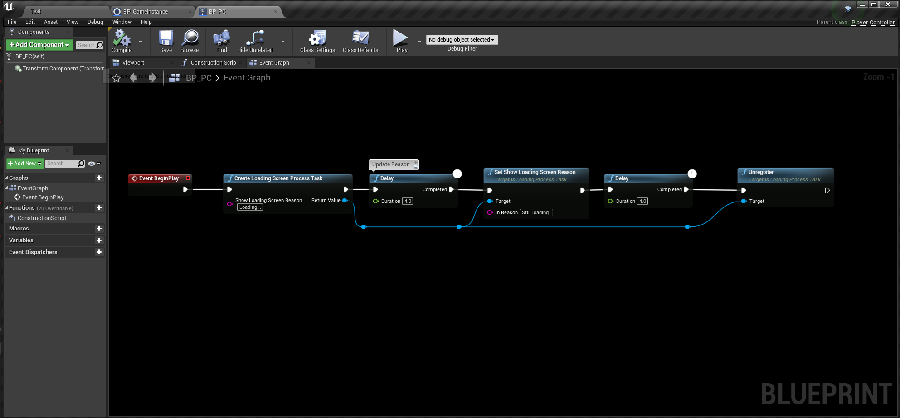
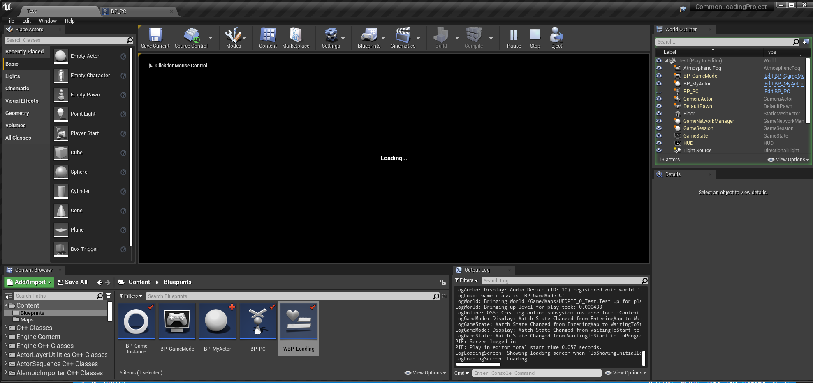
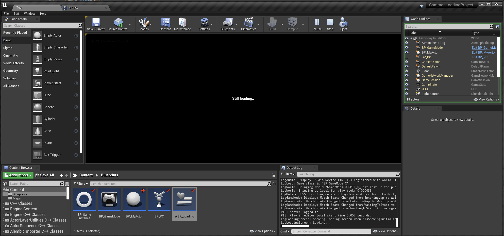

# Show on Demand

You can show the loading screen on demand from any Blueprint that has a world context, without implementing any interface.

Call **Create Loading Screen Process Task** with a reason. The loading screen is shown until you call **Unregister** on the returned task.

## Player Controller Example
- This example shows the loading screen for 4 seconds, called from the Player Controller Blueprint.

:::warning
The plugin keeps the task alive until you call **Unregister** on it. If you never call **Unregister**, the loading screen stays up, unless you set a timeout as described below.
:::

## Making the task stop by itself
Expand the advanced pins on **Create Loading Screen Process Task** to make sure a task can't keep the loading screen up forever:

- **Timeout Seconds**: the task is unregistered after this many seconds. `0` means no timeout, which is the default.
- **Unregister With Context Object**: the task is unregistered when the object that created it is destroyed, for example an Actor that is removed during a level change. Off by default.

When a task expires, the plugin unregisters it and logs a warning with the reason of the task. Use **Is Expired** on the task to check it yourself.

## Status text and progress
This example sets a timeout of 30 seconds, reports a status text and progress on the task, and unregisters it when the work is done.

## Updating Reason
- You can update the loading screen reason at any time with **Set Show Loading Screen Reason** on the task.

## The Result

