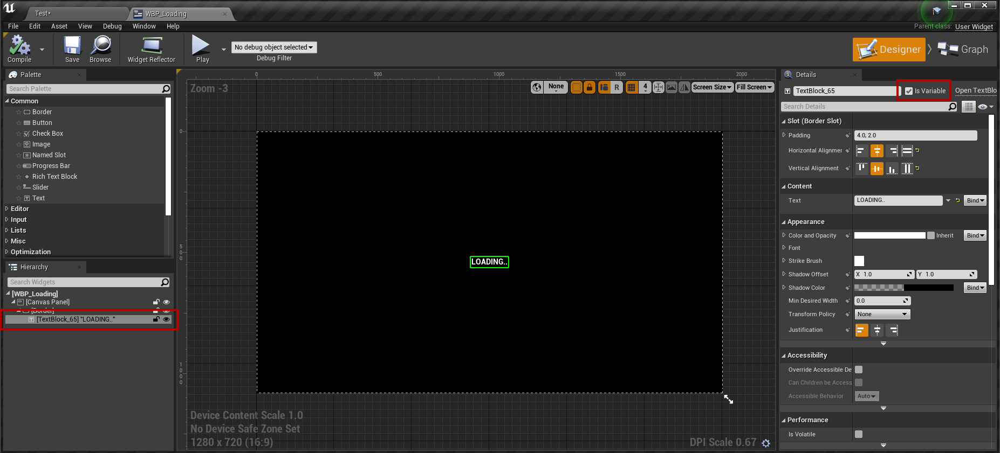
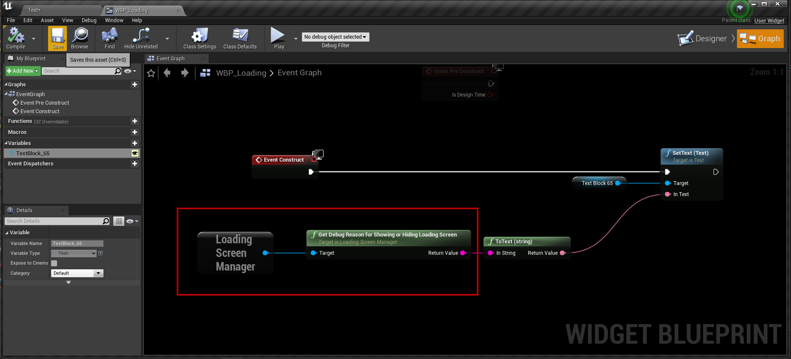
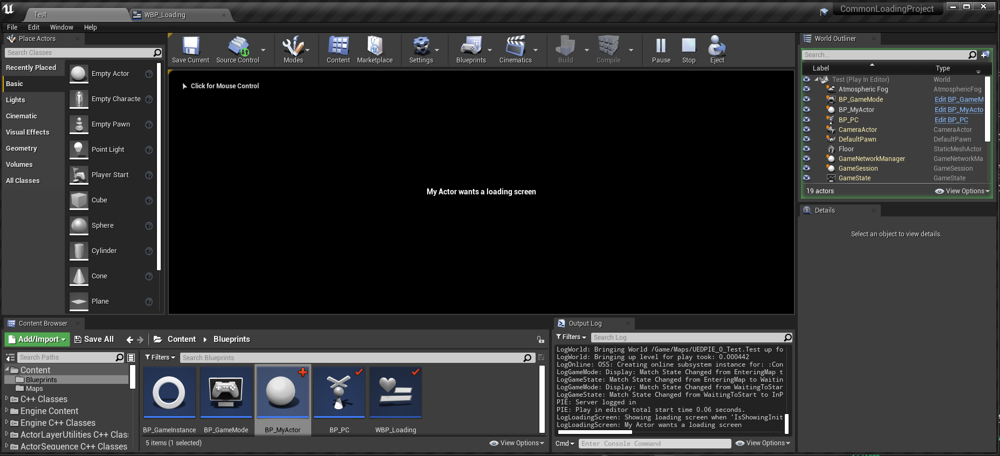
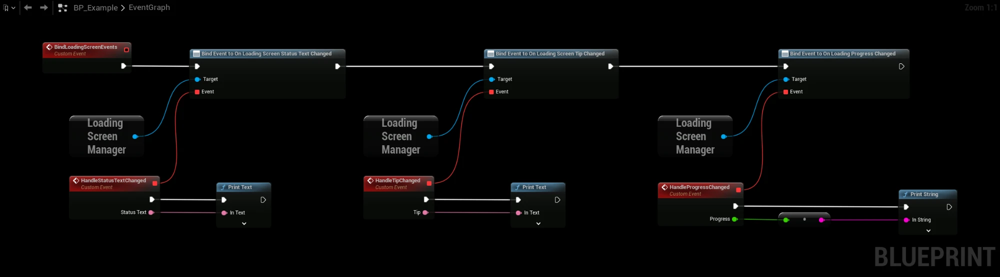

# Displaying Reason

The reason that you set in **Should Show Loading Screen** can be displayed in your widget to give the player useful feedback.

### Setting up the Widget
- We use a basic widget with a black background and a centered text field to display the reason.

### Updating the Reason
- Get the **Loading Screen Manager** and call **Get Debug Reason for Showing or Hiding Loading Screen** to get the reason for showing or hiding the screen.

### The Result
- With the [Actor Example](/docfiles/getting_started/watchers) from the Watchers page, the Loading Screen Manager returns "My Actor wants a loading screen", because we set that as the reason in the Actor.

## Custom Text
To show your own text instead, call **Set Loading Screen Custom Text** from anywhere, and read it in the widget with **Get Loading Screen Custom Text**. The plugin never changes the custom text itself.

For text that should be translated, use **Set Loading Screen Custom Display Text** and **Get Loading Screen Custom Display Text**, which take and return a localizable text. Both pairs set and read the same text.

## Status Text
The reason is meant for developers. To tell the player what is happening, read **Get Loading Screen Status Text** on the Loading Screen Manager in your widget, or bind **On Loading Screen Status Text Changed**. The [built-in loading screen](/docfiles/getting_started/built-in-loading-screen) shows it automatically.

The first of these that applies is used:

1. **Key Press Text**, while [waiting for a key press](/docfiles/concepts/how-it-works#waiting-for-a-key-press).
2. The custom text, if one is set.
3. A status text from a task or an object implementing the Loading Process Interface.
4. The text for what the game is doing: **Connecting Text**, **Loading Map Text**, **Streaming Levels Text**, **Compiling Shaders Text** or **Finishing Text**.
5. **Default Text**.

The texts in step 4 are set under **Loading Screen → Status Text** in Project Settings. They are empty by default, and an empty text uses **Default Text**. See [Status Text](/docfiles/reference/settings#status-text).

To report your own status, call **Set Status Text** on a task from [Create Loading Screen Process Task](/docfiles/getting_started/on-demand), or implement **Get Loading Status Text** in the Loading Process Interface. Return true and set **Out Status Text**.

The status text can't change while **Open Level** blocks the game thread. **Loading Map Text** is shown during the load.

This example binds the events for the status text, the tip and the progress. Replace the print nodes with **Set Text** and **Set Percent** in your widget.

