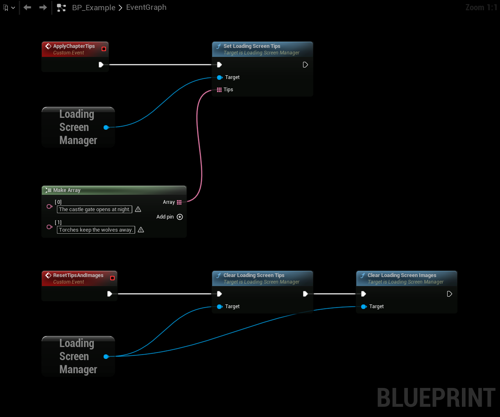

# Tips, Slideshow and Music

All three are set up in **Edit → Project Settings → Plugins → Common Loading Screen**, and are off until you add content. Use [Map Overrides](/docfiles/reference/settings#map-overrides) to have different tips, images or music for a specific map.

:::info
The images and the sound are only referenced from the settings. Add their folder to **Additional Asset Directories to Cook** under **Project Settings → Packaging**, or reference them from a cooked asset, so they are included in your packaged build.
:::

## Tips
Add your texts to **Tips**. The plugin picks a tip each time the loading screen is shown, and changes it every **Tip Duration** seconds.

To show the tip, add a text block to your widget and read **Get Current Loading Screen Tip** on the Loading Screen Manager, for example in a binding. You can also bind **On Loading Screen Tip Changed**, which fires with the new tip.

The tip can't change while **Open Level** blocks the game thread. It changes again when the map has loaded.

## Slideshow
Add images to **Images**. They are shown behind your **Loading Screen Widget**, scaled to fill the screen, with a crossfade between them.

- Your widget must be transparent where the images should be visible.
- With **Use Movie Player During Load Map**, the slideshow keeps running while the map loads. It is not shown over loading screen movies.
- All images are loaded when the game starts and stay in memory, so showing the loading screen doesn't hitch. Keep their number and size reasonable.

## Music
Set **Music** to the sound to play while the loading screen is shown. Use a looping sound, a sound that ends is not started again until the next loading screen.

The music fades in and out with **Music Fade In Duration** and **Music Fade Out Duration**, and continues to play across map loads.

## Changing tips and images while the game runs
Call these on the Loading Screen Manager to replace the tips or images from your own code, for example with tips for the current chapter:

| Node | Description |
|---|---|
| Set Loading Screen Tips | Uses these tips instead. If the loading screen is shown, a new tip is picked at once. |
| Clear Loading Screen Tips | Goes back to the tips from the settings. |
| Set Loading Screen Images | Uses these images instead, from the next loading screen. A loading screen that is already shown keeps its images. |
| Clear Loading Screen Images | Goes back to the images from the settings. |

- Tips and images set this way take priority over [Map Overrides](/docfiles/reference/settings#map-overrides) and the settings.
- They are kept across map loads, until you clear them or the game instance is shut down.
- Setting an empty list is the same as clearing.
- The images must already be loaded when you pass them in. The manager keeps them in memory until they are replaced or cleared.

This example replaces the tips, and goes back to the tips and images from the settings.

